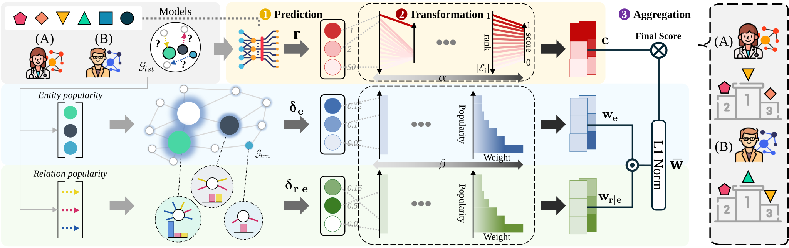

# Generalized Rank-based Evaluation for Knowledge Graph Completion: Perspectives, Framework, and Analyses
This repository provides the implementation of PROBE and its integration with existing Knowledge Graph Completion (KGC) models. It also contains the code required to reproduce the experimental results and figures presented in the paper.
## Overview of PROBE


## 📁 KnowledgeGraphEmbedding
This directory demonstrates how PROBE can be integrated into KGC training pipelines and used to evaluate models throughout the training process.

### Installation and Usage

We recommend using Python 3.11 or later.
```
cd KnowledgeGraphEmbedding
pip install -r requirements.txt

bash best_config.sh
```

## 📁 Testing
This directory contains the code used to generate all figures reported in the paper.

Install the analysis dependencies, then select figures or tables explicitly:

```bash
pip install -r Testing/requirements.txt
# Default: Tables 4 and 5, six datasets, original model set.
python Testing/src/run.py
# Selected analyses; omit --datasets to run all six datasets.
MPLBACKEND=Agg python Testing/src/run.py --datasets family --m15c --m16
# A single dataset/model analysis (plot paths are relative to Testing/src).
cd Testing/src
python main.py --data family --models RotatE ComplEx --m15c
```

The batch runner uses the current Python interpreter and stops on failed runs.
It excludes RNNLogic on YAGO3-10, where results are unavailable. Use `--models`
to choose a different model set (quote `'A*Net'` when selecting it in a shell).

`reb_m9` produces the same beta-sweep figures for base weights, 99th-percentile
clipping, uniform shrinkage with lambda 0.1, and logarithmic compression.
The query-weight, aggregated-mass, Lorenz/Gini, ESS, and top-mass PDFs use the
same templates for every variant. Beta curves retain tab10 colors, while
ESS uses brown and top-mass percentiles use a sequential grey palette, with
legend entries ordered Top 10%, Top 5%, Top 1%. Original filenames are
retained; variant filenames append `_clip_99`, `_shrink_0.1`, or `_log` before
`.pdf`. Only figures are written under `Testing/figs/m9/`; no CSV files are
produced. All figures have grey horizontal y-tick grids (alpha 0.7), and Lorenz
plots omit the redundant Uniform reference.
The existing combined mitigation plots at beta 0.8 remain available.

## Requirements
Python >= 3.11
Dependencies listed in requirements.txt

## Citation

If you find this repository useful in your research, please consider citing our paper.
```
@article{moon2026generalized,
  title={Generalized Rank-based Evaluation for Knowledge Graph Completion: Perspectives, Framework, and Analyses},
  author={Moon, Sooho and Kang, Jian and Ko, Yunyong},
  journal={ACM Transactions on Knowledge Discovery from Data},
  year={2026}
}
```

## Acknowledgement
We thank the original authors for their great works.
## Baseline metrics (M15)

Recompute the additional baselines from the released saved ranks, without retraining:

```bash
python Testing/src/baseline_metrics.py --data family --models RotatE ComplEx
# All available original models and datasets:
python Testing/src/run.py --baselines
# An independent export (candidate counts include the target):
python Testing/src/baseline_metrics.py --records /path/to/records.json --nentity 1000 --output /tmp/baselines.json
```

Outputs default to `Testing/figs/baselines/<dataset>_answer.json` and `.csv`.
They contain MRR, Hits@1/3/10, 2/3-MRR (`P2_3`), 1/3-MRR (`P1_3`),
ZMRR, AMRI, and adjusted weighted geometric mean rank (`WMR_BAR`). JSON records
source checksums, per-run scores, and model means/sample standard deviations.
Every metric uses the same saved ranks and candidate counts, without rounding
fractional tie ranks. Default averaging is per answer; use `--aggregation query`
in the baseline script for equal mass per nonempty query. CSV contains per-run
scores. `--m15c` compares candidate-size sensitivity using the same baseline
implementations. See [Testing/RANK_METRICS.md](Testing/RANK_METRICS.md) for
formulas, null expectations, and the separate OWA history commands.

## PROBE parameters and defaults

The implementation's default baseline is **alpha = 1.0, beta = 0.0**.
Both the constructor and `calculate_final_metric()` expose these defaults.
For paired head/tail records, a minimal use is:

```python
from PROBE import PROBE

metric = PROBE(model="RotatE", data="family", info_dump=records,
               nentity=nentity, nrelation=nrelation)
score = metric.calculate_final_metric()  # alpha=1, beta=0, normalized ranks
```

Alpha controls the normalized rank transform. At alpha = 1 it is a normalized
reciprocal-rank score; alpha = 0 uses its logarithmic limit. Smaller alpha values
place relatively more emphasis on improvements at larger ranks. Beta controls
both target entity and conditional relation frequency factors:

```text
N_i = nentity - filtered_count_i
f_alpha(r_i, N_i) = (r_i^(-alpha) - N_i^(-alpha)) / (1 - N_i^(-alpha))
f_0(r_i, N_i) = 1 - log(r_i) / log(N_i)
u_i = (epsilon_entity + P(e_i))^(-beta)
      * (epsilon_relation + P(r_i | e_i))^(-beta)
PROBE = sum(u_i * f_alpha(r_i, N_i)) / sum(u_i)
```

Use alpha = 1, beta = 0 for uniform answer weighting. Choose a positive beta
when evaluation should emphasize rarer targets, and report the chosen pair for
all compared models. For sensitivity analysis, the released scripts use
alpha in `{1, 0.5, 0, -0.5, -1}` and beta in `{0, 0.2, 0.4, 0.6, 0.8}`;
these are experiment grids, not additional defaults. Supply the training
epsilons below before using nonzero beta. Passing `tmode='f'` selects the
unnormalized reciprocal-rank power; at alpha = 1, beta = 0 this recovers MRR.

The old PROBE `gamma` argument was ignored by the final scorer: beta already
controlled both weight factors. It remains accepted with a `DeprecationWarning`
for compatibility; new calls should use `calculate_final_metric(alpha, beta)`.
There is no independent gamma sweep. The KGC models' `--gamma` score margin is
a separate model parameter and retains its original meaning.

## Training-referenced smoothing for PROBE

The weight epsilons are the minimum positive training entity probability
`P(e) = degree(e) / sum(degrees)` and training conditional relation probability
`P(r | e) = count(e, r) / degree(e)`, over the full training graph. Both head
and tail incidences contribute to the counts. The same constants are shared by
all models, seeds, and evaluation subsets of a training split. Evaluation
records select target probabilities but do not determine the epsilons.
For nonuniform scoring, compute and pass them explicitly:

```python
eps_e, eps_r = PROBE.training_epsilons(entity_probabilities, relation_probabilities)
metric = PROBE(model="RotatE", data="family", info_dump=records,
               nentity=nentity, nrelation=nrelation,
               epsilon_entity=eps_e, epsilon_relation=eps_r)
score = metric.calculate_final_metric(alpha=1.0, beta=0.4)
```

`entity_probabilities` contains the full training P(e) values, and
`relation_probabilities` maps entities to their training P(r | e) arrays.
Epsilons are fixed training statistics, not tuned hyperparameters. Zero
probabilities are excluded when computing the minima and remain valid targets.
Nonuniform weights require these constants; there is no evaluation-minimum
fallback. Table JSON sidecars record the training reference and both epsilons.

Run `python run.py` from `Testing/src` to regenerate Table 4 and Table 5 for
all six datasets, excluding AStarNet. RNNLogic is omitted on YAGO3-10 because
its results are unavailable.

## M16 model dispersion across beta

From `Testing/src`, run M16 with your dataset and models:

```bash
python main.py --data FB15k237 --models RotatE ComplEx --m16
```

Alongside the performance bars, this saves
`Testing/figs/m16/FB15k237_alpha_1.0_beta_variance.pdf`: beta on the x axis
and sample variance divided by the same model's mean at that beta on the
y axis, shown as a percentage over a fixed 0–0.5% range, with each model in
its signature color and the legend above the dataset title.
For example, mean 0.5 and variance 0.1 corresponds to 20% (outside the
displayed variance range).
The extra figure always uses
alpha = 1.0 with beta shared by both weight factors. Add `--m16-dispersion std` to plot sample standard deviation
divided by the same model/beta mean instead, saved with the `_beta_std.pdf` suffix.
